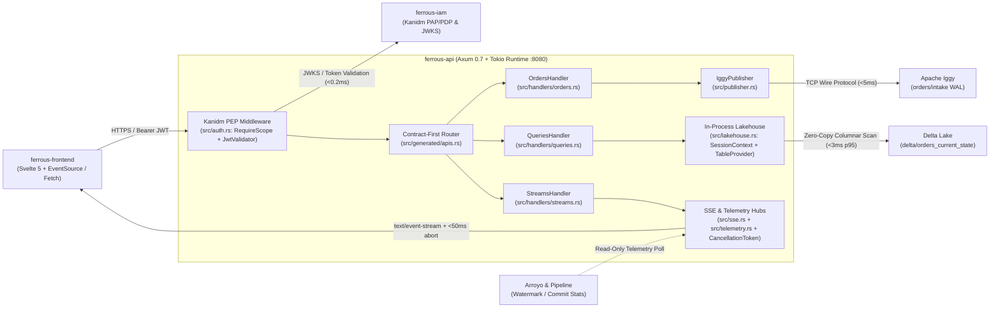

# ferrous-api

[<- Back to FerrousCX Root Architecture](https://github.com/reidlai/ferrous-cx)

> **Contract-First Rust/Axum API Service for FerrousCX Platform**  
> Driven by [Goa Design v3](https://goa.design/) as the declarative API specification DSL (`design/`), compiled to OpenAPI v3 (`gen/http/openapi3.json`) and strongly typed Rust/Axum traits (`src/generated/`), with Kanidm JWT PEP middleware, direct Apache Iggy WAL command ingestion, in-process columnar lakehouse SQL (`SessionContext`), and cooperative-cancellation Axum SSE streams.

---

## C4 Architecture Slice (Container & Component View)



---

## Contract-First Pipeline

1. **Declarative Contract Modeling (`design/`):** API routes, request/response models, validation constraints, and Kanidm JWT security scopes are declared in Goa Design v3 DSL (`design/design.go`, `orders.go`, `queries.go`, `streams.go`).
2. **OpenAPI v3 Generation (`gen/http/openapi3.json`):** `scripts/generate-openapi.ps1` / `.sh` compiles or validates the canonical OpenAPI 3.0.3 specification.
3. **Rust-Axum Codegen (`src/generated/`):** `scripts/generate-axum.ps1` / `.sh` generates or validates strongly typed Axum server traits (`OrdersApi`, `QueriesApi`, `StreamsApi`), `ValidatedJson<T>`, and RFC 7807 `ProblemDetails`.
4. **Pure-Rust Handlers (`src/handlers/`):** `OrdersHandler`, `QueriesHandler`, and `StreamsHandler` implement the generated traits without drift.

---

## OpenAPI Endpoint Table

Authoritative contract: [`gen/http/openapi3.json`](gen/http/openapi3.json) & [`src/generated/apis.rs`](src/generated/apis.rs).

| Method | Path | Operation / Handler | Auth Scope | Responses | Description |
| :--- | :--- | :--- | :--- | :--- | :--- |
| `POST` | `/api/v1/commands/orders/issue-credit` | `orders#issue_credit` | `jwt_bearer` (`api:write`) | `202`, `400`, `401`, `403`, `422`, `500` | Dispatch `IssueCourtesyCredit` command to Iggy WAL |
| `POST` | `/api/v1/commands/orders/cancel` | `orders#cancel_order` | `jwt_bearer` (`api:write`) | `202`, `400`, `401`, `403`, `422`, `500` | Dispatch `CancelOrder` command to Iggy WAL |
| `GET` | `/api/v1/orders/{order_id}` | `queries#get_order` | `jwt_bearer` (`api:read`) | `200`, `400`, `401`, `404`, `500` | Fetch single order details by ID from Delta Lake |
| `GET` | `/api/v1/orders` | `queries#list_orders` | `jwt_bearer` (`api:read`) | `200`, `400`, `401`, `500` | Query paginated orders from Delta Lake table |
| `GET` | `/api/v1/events/stream` | `streams#event_stream` | `jwt_bearer` (`api:read`) | `200` (`text/event-stream`), `400`, `401`, `500` | Stream domain events and AI agent thoughts over SSE |
| `GET` | `/api/v1/benchmarks/{run_id}/stream` | `streams#benchmark_stream` | `jwt_bearer` (`api:read`) | `200` (`text/event-stream`), `400`, `401`, `404`, `500` | Stream real-time TTFT and token performance metrics |
| `GET` | `/api/v1/telemetry/pipeline/stream` | `streams#pipeline_telemetry_stream` | `jwt_bearer` (`api:read`) | `200` (`text/event-stream`), `401`, `500` | Read-only pipeline watermark lag and commit counts |
| `GET` | `/healthz` | Liveness probe | Public | `200` (`text/plain`) | Process liveness check |
| `GET` | `/health/ready` | Readiness probe | Public | `200` (`text/plain`) | Service readiness check |

---

## Repository Layout

```text
ferrous-api/
├── .github/workflows/
│   └── devsecops-ci.yml         # Tier 1 Rust CI (fmt, clippy, test, audit, deny, semgrep)
├── .pre-commit-config.yaml      # Shift-left hooks (hygiene, gitleaks, fmt, clippy, test)
├── deny.toml                    # cargo-deny advisories, license allowlist, bans, sources
├── design/                      # Goa v3 API Design DSL (Single Source of Truth)
│   ├── design.go                # API root, security schemes & RFC 7807 errors
│   ├── orders.go                # Orders, credits, and dispute command endpoints
│   ├── queries.go               # Analytical query endpoints (lakehouse)
│   └── streams.go               # SSE stream definitions
├── gen/
│   └── http/
│       └── openapi3.json        # Compiled OpenAPI v3.0.3 specification
├── scripts/
│   ├── audit-api.ps1            # Tier 1 local audit & scan gate (PowerShell, <3 min)
│   ├── audit-api.sh             # Tier 1 local audit & scan gate (POSIX/Bash, <3 min)
│   ├── build-and-scan.ps1       # Tier 2 Hadolint + Docker build + Trivy scan (PowerShell)
│   ├── build-and-scan.sh        # Tier 2 Hadolint + Docker build + Trivy scan (POSIX/Bash)
│   ├── generate-openapi.ps1/.sh # Executes/validates 'goa gen' -> gen/http/openapi3.json
│   └── generate-axum.ps1/.sh    # Executes/validates 'openapi-generator' -> src/generated/
├── src/
│   ├── generated/               # Generated Rust models, traits, and router (DO NOT EDIT)
│   │   ├── apis.rs              # Axum API server traits & build_api_router()
│   │   ├── models.rs            # Serde DTOs & ValidatePayload implementations
│   │   └── mod.rs
│   ├── handlers/                # Domain implementations of generated Axum traits
│   │   ├── orders.rs            # Implements OrdersApi (Iggy WAL dispatch)
│   │   ├── queries.rs           # Implements QueriesApi (lakehouse scans)
│   │   ├── streams.rs           # Implements StreamsApi (SSE & telemetry streams)
│   │   └── mod.rs
│   ├── auth.rs                  # Kanidm JWT PEP middleware, RequireScope & JWKS cache
│   ├── lakehouse.rs             # Embedded SessionContext, DeltaTableProvider & federation
│   ├── lib.rs                   # Library exports & router assembly helpers
│   ├── main.rs                  # Axum HTTP server bootstrap (:8080)
│   ├── publisher.rs             # IggyPublisher trait, InMemoryIggyPublisher & TcpIggyPublisher
│   ├── sse.rs                   # EventStreamBroadcaster & CancellationToken abort guard
│   ├── state.rs                 # Shared AppState wiring dependencies
│   └── telemetry.rs             # BenchmarkTelemetryBroadcaster & PipelineTelemetryHub
├── tests/                       # Integration & contract test suites
│   ├── test_auth_middleware.rs
│   ├── test_command_ingestion.rs
│   ├── test_generated_traits.rs
│   ├── test_healthcheck_probe.rs
│   ├── test_lakehouse_queries.rs
│   ├── test_openapi_contract.rs
│   ├── test_sse_cancellation.rs
│   └── test_telemetry_streams.rs
├── .dockerignore                # Excludes build artifacts and git metadata from image context
├── Cargo.toml                   # Crate manifest (depends on ../ferrous-cqrses)
├── Cargo.lock
├── Dockerfile                   # Hardened multi-stage musl -> FROM scratch container (<50MB)
├── docker-compose.yml           # Day-0 hardened standalone Compose manifest (UID 10001)
├── go.mod
└── README.md
```

---

## Standalone Quickstart & Verification (< 3 Minutes)

Run and verify `ferrous-api` standalone without Docker or external services (in-memory Iggy WAL, local JWT validator, and embedded columnar lakehouse initialize automatically by default):

> **Prerequisites:**
> - Rust stable toolchain (`rustfmt`, `clippy`) plus a C compiler (`cc`) and `cmake` (required to build `aws-lc-sys` for `jsonwebtoken` FIPS/audited TLS crypto).
> - Sibling `../ferrous-cqrses` directory checked out alongside `ferrous-api` (present automatically in the `ferrouscx-bmad` superproject; referenced via path dependency in `Cargo.toml`).

### 1. Run the Full Tier 1 Local Audit Gate (`< 3 minutes`)

**Windows (PowerShell):**
```powershell
powershell -ExecutionPolicy Bypass -File .\scripts\audit-api.ps1
```

**Linux / macOS (Bash):**
```bash
./scripts/audit-api.sh
```

The audit script executes all 6 Tier 1 Rust DevSecOps gates in sequence:
1. `cargo fmt --all -- --check` — formatting check
2. `cargo clippy --all-targets -- -D warnings` — zero-warning static analysis
3. `cargo test --all-targets` — unit, contract, auth, lakehouse, and SSE cancellation tests
4. `cargo audit` — RustSec dependency vulnerability scan
5. `cargo deny check` — supply-chain, advisory, and license compliance (`deny.toml`)
6. `semgrep scan --config auto --error --quiet .` — SAST security scan (skipped with `[WARN]` locally if `semgrep` is not installed; enforced in CI)

### 2. Run the Standalone API Server

```bash
cargo run --bin ferrous-api
```
- **HTTP & SSE Service Endpoint:** `http://localhost:8080`
- **Liveness Probe:** `GET http://localhost:8080/healthz`
- **Readiness Probe:** `GET http://localhost:8080/health/ready`

### 3. Optional Pre-Commit Setup

```bash
pre-commit install
pre-commit run --all-files
```

---

## Container Packaging & Tier 2 Security Scan (AD-24)

`ferrous-api` packages a statically linked `x86_64-unknown-linux-musl` binary into a rootless `FROM scratch` container (`<50MB`, `USER 10001:10001`) with no shell, package manager, or dynamic linker. Health checks use the embedded `/ferrous-api --healthcheck` CLI probe querying `GET /health/ready` on `127.0.0.1:${PORT:-8080}`.

`docker-compose.yml` enforces Day-0 kernel hardening (`read_only: true`, `cap_drop: ["ALL"]`, `security_opt: ["no-new-privileges:true"]`, `tmpfs /tmp:noexec,nosuid,nodev,size=64M`) and mounts the Delta Lake directory read-only at `/data/delta` (`DELTA_DATA_DIR=/data/delta`, `DELTA_ORDERS_PATH=/data/delta/orders_current_state`).

**Build & Scan (Windows PowerShell):**
```powershell
powershell -ExecutionPolicy Bypass -File .\scripts\build-and-scan.ps1
# Dry-run or skip Trivy:
powershell -ExecutionPolicy Bypass -File .\scripts\build-and-scan.ps1 -DryRun
powershell -ExecutionPolicy Bypass -File .\scripts\build-and-scan.ps1 -SkipScan
```

**Build & Scan (Linux / macOS Bash):**
```bash
./scripts/build-and-scan.sh
# Dry-run or skip Trivy:
./scripts/build-and-scan.sh --dry-run
./scripts/build-and-scan.sh --skip-scan
```
